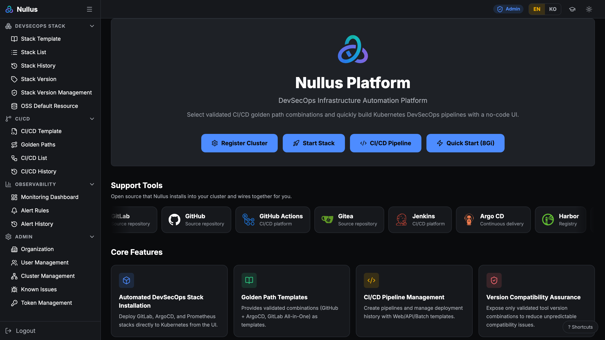
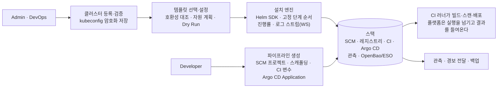
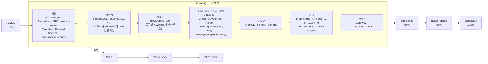

# Nullus Platform

Kubernetes 기반 DevSecOps 자동화 오픈소스 플랫폼

[](https://www.apache.org/licenses/LICENSE-2.0)


**[📖 문서 사이트](https://cloud-nullus.github.io/nullus/)** · **[🚀 라이브 데모](https://cloud-nullus.github.io)** · **[▶️ 시연 영상](https://www.youtube.com/watch?v=VrTqBKInlNw)**

## Nullus 란

검증된 OSS 조합(GitLab·Argo CD·Harbor·Prometheus·Grafana·OpenBao …)을 **Golden Path 템플릿**으로 고르고, 웹 UI 에서 노코드로 설정한 뒤 **한 번의 배포로 Kubernetes 클러스터에 DevSecOps 스택을 설치**하는 플랫폼입니다. 설치한 스택 위에 파이프라인을 만들면 저장소·CI 정의·레지스트리·Argo CD 연동까지 자동으로 묶이고, 빌드 앞뒤에 보안 게이트(시크릿 탐지·의존성 취약점·SAST·이미지 스캔)가 들어갑니다.

프로젝트마다 클러스터에 파이프라인을 반복 설치하면서 팀마다 절차가 달라지고, OSS 조합의 버전 호환성을 매번 검토하는 비용을 없애는 것이 목표입니다. 플랫폼 팀은 템플릿과 호환성 정책을 운영하고, 개발 팀은 검증된 파이프라인을 바로 씁니다.



지원하는 조합은 세 가지입니다 — **GitLab**(All-in-One · Argo CD · Harbor · Nexus · SonarQube · OTel), **GitHub + Argo CD**(저장소·Actions·GHCR 은 외부 서비스, 클러스터에는 Argo CD 와 관측만), **Gitea + Jenkins + Argo CD**(Lite 포함). 가장 많이 검증된 경로는 GitLab 입니다. 화면별 사용법은 [문서 사이트](https://cloud-nullus.github.io/nullus/features/)에 있습니다.

## 설치

### 요구사항

Docker + Docker Compose, Go 1.26+, Node.js 22+. 클러스터에 스택을 설치해 보려면 kind 와 kubectl·helm 이 더 필요합니다. 버전 근거는 [준비물](https://cloud-nullus.github.io/nullus/getting-started/prerequisites/)에 있습니다.

### 로컬에서 띄우기

```bash
./scripts/runbook_local.sh preflight   # 도구 확인
./scripts/runbook_local.sh up          # 인프라(PostgreSQL·오브젝트 스토리지·Redis·Keycloak) + 마이그레이션 + API + 웹
```

| 주소 | 무엇 |
|------|------|
| http://localhost:5173 | 웹 |
| http://localhost:8090 | API (`/health` 의 `db` 가 `connected` 면 정상) |
| http://localhost:8180 | Keycloak |

`refresh` 는 백엔드·프런트엔드를 다시 빌드해 띄우고, `down` 은 전부 내립니다. 손으로 띄우려면 `make dev` → `make run` → `make web-dev` 순서입니다.

### 클러스터에 스택 설치해 보기

```bash
./scripts/runbook_local.sh kind-up                                   # kind 클러스터 두 개 (nullus-platform · nullus-develop)
./scripts/register-kind-clusters.sh                                  # 클러스터 등록 (UI 의 Cluster Management 에서도 가능)
./scripts/runbook_local.sh stack-up --template=gitlab-argocd-v1 --wait   # 템플릿으로 설치, 끝까지 기다림
./scripts/runbook_local.sh stack-down                                # 설치한 스택 삭제 (제품 삭제 경로 그대로)
```

`stack-up` 은 helm 을 직접 부르지 않고 백엔드 API 를 호출하므로 UI 설치와 같은 경로를 탑니다. 클러스터 등록부터 파이프라인 실행·백업까지 한 바퀴는 [로컬 E2E 가이드](./docs/50_운영/Nullus_로컬_E2E_가이드.html)에 순서대로 적혀 있습니다.

### 클러스터에 Nullus 배포하기

플랫폼 자체는 Helm 차트로 배포합니다. `deploy/helm/nullus/values.yaml` 을 복사해 도메인·DB·OIDC 를 채운 뒤:

```bash
helm upgrade --install nullus deploy/helm/nullus \
  --namespace nullus-system --create-namespace \
  -f my-values.yaml
```

DB 마이그레이션은 차트의 훅 Job(`post-install`·`pre-upgrade`)이 함께 돌립니다. 폐쇄망에는 `airgap/` 의 번들 스크립트로 이미지·차트를 반입해 설치합니다. 배포 구성은 [인프라 배포 설계](./docs/50_운영/Nullus_인프라_배포_설계.md)를 참고하세요.

### 접속 계정

Mock Auth(`up --auth=none` 으로 띄웠을 때, 웹에서 바로 로그인):

| 역할 | 이메일 | 비밀번호 | 홈 |
|------|--------|----------|----|
| Admin | admin@nullus.dev | admin123 | /admin/organization |
| DevOps | devops@nullus.dev | devops123 | /stack/templates |
| Developer | developer@nullus.dev | developer123 | /cicd/developer-deploy |

Keycloak OIDC(기본값 `--auth=keycloak`, 웹 로그인이 Keycloak 으로 넘어감):

| 역할 | 이메일 | 비밀번호 |
|------|--------|----------|
| Admin | admin@nullus.io | nullus123! |
| DevOps | devops@nullus.io | nullus123! |
| Developer | dev@nullus.io | nullus123! |

로컬 인프라:

| 서비스 | 주소 | 계정 |
|--------|------|------|
| PostgreSQL | localhost:5433 | nullus / nullus_dev |
| Keycloak Admin | localhost:8180 | admin / admin |
| 오브젝트 스토리지 콘솔 (SILO, MinIO 호환) | localhost:9001 | nullus / nullus_dev |
| Redis | localhost:6380 | - |

## 동작 방식



- **스택 설치**는 템플릿이 고른 도구를 아래 [코어 DAG](#코어-dag--스택-설치-단계) 순서로 Helm SDK 로 깝니다. 시크릿은 스택마다 설치되는 OpenBao 에 두고 External Secrets 가 Kubernetes Secret 으로 나릅니다. 도구별 SSO 클라이언트는 플랫폼 Keycloak 에 자동 등록됩니다.
- **파이프라인 생성**은 스택의 SCM 에 프로젝트를 만들고 CI 정의·Dockerfile·매니페스트를 스캐폴딩해 첫 커밋으로 올립니다. 레지스트리 자격증명과 스캔 정책은 CI 변수로 싣고, Argo CD Application 을 만들어 매니페스트를 동기화합니다.
- **실행**은 플랫폼이 빌드하지 않습니다. GitLab CI·GitHub Actions·Jenkins 에 실행을 넘기고(위임), CI 가 이미지를 올려 매니페스트 태그를 되커밋하면 Argo CD 가 배포합니다. 실행 기록은 CI 서버에서 주기적으로 들여옵니다.
- **보안 게이트**는 빌드 앞뒤에 서며 스택 정책으로 차단·경고·끄기를 고릅니다.

| 순서 | 단계 | 생기는 조건 |
|------|------|-------------|
| 1 | `SecretScan` (gitleaks) | 항상 |
| 2 | `DependencyScan` (Trivy SCA) | 설치 때 SCA 를 골랐을 때 |
| 3 | `Build` | 항상 |
| 4 | `SAST` (SonarQube, Quality Gate) | 설치 때 SAST 를 골랐을 때 |
| 5 | `ImageScan` (Trivy) | 설치 때 이미지 스캐너를 골랐을 때 |
| 6 | `Deploy` (매니페스트 되커밋 → Argo CD) | 항상 |

- **관측**은 Prometheus 질의가 아니라 클러스터 kubeconfig 로 Kubernetes 에 직접 붙어 파드·CPU·메모리를 모읍니다. 스택의 Prometheus 가 평가한 심각 경보는 플랫폼이 1분마다 가져와 Telegram·이메일·Slack 으로 보냅니다.
- **백업**은 플랫폼 DB·Keycloak·금고·클러스터 리소스·볼륨을 암호화해 외부 오브젝트 스토리지에 뜨고 되돌립니다(복구는 API 전용).

## 아키텍처

**Frontend** React 19 + TypeScript + Vite + Tailwind CSS 4 · **Backend** Go 1.26 (Echo v4) + PostgreSQL 17 · **Auth** Keycloak OIDC + JWT + RBAC(Admin/DevOps/Developer) · **Infra** Helm v3, Kubernetes 1.34+, kind(로컬)

**Modular Monolith** 로 시작해 모듈 경계를 바운디드 컨텍스트로 유지하고, 각 모듈은 **Clean Architecture** 로 의존성이 도메인을 향합니다. 모듈 사이는 공개 인터페이스와 도메인 이벤트로만 통신하고, 테이블은 모듈이 소유합니다.

```
[Handler] → [UseCase] → [Domain]
    ↓            ↓
[Port 인터페이스] → [Adapter: Postgres · Helm · Kubernetes · SCM API]
```

| Context | 모듈 | 핵심 기능 |
|---------|------|----------|
| Stack Management | `internal/stack/` | 템플릿·호환성·자원 계획, 설치 엔진(Helm SDK), 삭제·공용 자원 회수 |
| CI/CD Pipeline | `internal/cicd/` | SCM 프로비저닝·스캐폴딩, CI 위임, 실행 기록·스캔 결과 |
| Observability | `internal/observability/` | 클러스터·스택 지표, 스택 경보 수집 |
| Organization | `internal/admin/` | 조직·사용자·클러스터·토큰, 감사 로그 |
| Auth | `internal/auth/` | Keycloak OIDC, JWT, RBAC, 도구 SSO 프로비저닝 |
| Backup | `internal/backup/` | 백업·복구 |
| Notification | `internal/notification/` | 알림 채널, 발송·재시도·이력 |

역할 검사는 계층이 아니라 명단입니다 — `/admin` 은 Admin, `/stacks` 는 Admin·DevOps, `/cicd` 는 세 역할 모두. 자세한 표는 [권한 표](https://cloud-nullus.github.io/nullus/reference/rbac/), 설계 전체는 [시스템 아키텍처](./docs/20_아키텍처/Nullus_시스템_아키텍처.md)에 있습니다.

## 코어 DAG — 스택 설치 단계

설치 엔진이 밟는 단계와 진행률의 단일 출처는 [`internal/stack/domain/deploy_steps.go`](./internal/stack/domain/deploy_steps.go) 의 `InstallStepOrder` 입니다. 현재 구현은 이 순서를 **고정 체인**으로 돌며(설계의 병렬 DAG 엔진은 아직 아닙니다), 템플릿에서 고르지 않은 도구의 스텝은 건너뜁니다. 설치 구간은 5~90% 를 스텝 수로 균등하게 나눕니다.



삭제는 `deleting_started` → `deleting_release`(helm uninstall) → `deleting_manifest`(CRD·ClusterRoleBinding 정리) → `deleted` 순서이며, 클러스터의 마지막 스택을 지울 때는 함께 쓰던 공용 자원(cert-manager·내부 CA·metrics-server·Gateway API CRD)도 Nullus 가 설치한 것이면 회수합니다.

## 프로젝트 구조

```
nullus/
├── cmd/
│   ├── api/                # API 서버 진입점
│   ├── nullus/             # CLI (version · stack ls · mcp serve)
│   ├── nullus-bootstrap/   # 무인 설치용 부트스트랩 자격 발급
│   └── token-source-sync/  # 토큰 소스 동기화
├── configs/                # 설정 파일 (config.yaml)
├── db/migrations/          # DB 마이그레이션
├── deploy/helm/nullus/     # Nullus Helm 차트
├── airgap/                 # 폐쇄망 번들 스크립트
├── internal/               # 모듈 (Clean Architecture: domain · usecase · port · adapter)
│   ├── admin/              # 조직·클러스터·사용자·토큰
│   ├── auth/               # Keycloak OIDC · JWT · RBAC · SSO 프로비저닝
│   ├── backup/             # 백업·복구
│   ├── cicd/               # 파이프라인 프로비저닝·CI 위임·실행 기록
│   ├── cli/                # CLI 명령
│   ├── mcp/                # MCP 서버 (stdio)
│   ├── notification/       # 알림 채널 (Telegram · 이메일 · Slack)
│   ├── observability/      # 모니터링, 스택 경보 수집
│   ├── stack/              # 스택 템플릿·호환성·설치 엔진
│   └── shared/             # 설정 · 미들웨어 · 감사 · 이벤트 계약
├── pkg/crypto/             # AES-256 암호화
├── scripts/                # 런북(runbook_local.sh) · Keycloak · kind
├── web/                    # React 프런트엔드 (src/features/<모듈>, e2e/)
├── e2e/                    # Go E2E 테스트
├── website/                # 문서 사이트 (MkDocs Material)
├── docs/                   # 기획 · 아키텍처 · 운영 · 테스트 문서
└── Makefile
```

## 라이선스

[Apache License 2.0](./LICENSE)

## 참고 문서

- [문서 사이트](https://cloud-nullus.github.io/nullus/) — [시작하기](https://cloud-nullus.github.io/nullus/getting-started/) · [기능별 사용법](https://cloud-nullus.github.io/nullus/features/) · [API/CLI/MCP/설정 레퍼런스](https://cloud-nullus.github.io/nullus/reference/)
- [로컬 E2E 가이드](./docs/50_운영/Nullus_로컬_E2E_가이드.html) — 클러스터 등록 → 스택 설치 → 파이프라인 → 배포 → 백업·복구 한 바퀴 (브라우저로 열어 보세요)
- [시스템 아키텍처](./docs/20_아키텍처/Nullus_시스템_아키텍처.md) · [API 설계](./docs/20_아키텍처/Nullus_API_설계.md) · [인프라 배포 설계](./docs/50_운영/Nullus_인프라_배포_설계.md)
- [PRD v1.3](./docs/10_제품기획/nullus_PRD_1.3.md) · [ROADMAP](./docs/70_전략/ROADMAP.md) · [CHANGELOG](./CHANGELOG.md)
- [CONTRIBUTING](./CONTRIBUTING.md) — 개발 환경·브랜치·커밋 규칙·테스트 가이드 · [PR·커밋 컨벤션](./docs/20_개발가이드/Nullus_PR_커밋_컨벤션.md) · [CLAUDE.md](./CLAUDE.md) — 아키텍처 원칙
- [2차 기술 검증 발표 장표](./docs/80_프로젝트관리/Nullus_2차기술검증_발표장표.html)
- 문의: [GitHub Issues](https://github.com/cloud-nullus/nullus/issues) (버그·기능 요청) · [Discussions](https://github.com/cloud-nullus/nullus/discussions) (질문·아이디어)
