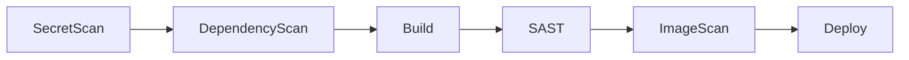

# CI/CD

This is where you create and run application pipelines. The API lives under
`/api/v1/cicd/**`, and **all three roles** can call it.

[**CI/CD Template**Pick a base template and go to the App Deploy screen.](templates.md)

[**Golden Paths**Recommended paths with a fixed tool combination. They lead to stack install.](golden-paths.md)

[**CI/CD List**Pipeline status, resources, vulnerabilities, and run history.](list.md)

[**CI/CD History**Deployment records in chronological order.](history.md)

[**App Deploy**The developer's landing screen. Puts one app on a pipeline.](app-deploy.md)

## Stages a pipeline actually runs

The CI definition that Nullus writes to the repository lays out jobs in the order
below. Stages whose conditions are not met are left out.

| Stage | Tool | Enabled when |
|------|----------|------------|
| `SecretScan` | gitleaks | **Always**. The only way to turn it off is `NULLUS_SECRET_DETECTION=off` at run time |
| `DependencyScan` | Trivy (filesystem) | The stack provides an SCA endpoint |
| `Build` | `docker build` / `docker push` | Always |
| `SAST` | sonar-scanner (`-Dsonar.qualitygate.wait=true`) | The stack provides SonarQube. Default branch only |
| `ImageScan` | Trivy (image) | The stack provides Trivy |
| `Deploy` | Changes the manifest tag, then commits and pushes with `[skip ci]` | Always |

**No job depends on the app type (web/backend/batch).** The only difference is
that `web` also gets React source and a Dockerfile.

!!! note "Argo CD does the actual deployment"
    The generated CI contains no `argocd` CLI call or sync job. The `Deploy` stage
    stops at committing a new image tag to the deployment manifest; Argo CD
    follows that commit and applies it.

## The CI platform decides the definition file

What matters is the **CI platform**, not the source repository.

| CI platform | File written |
|-----------|-------------|
| GitLab CI | `.gitlab-ci.yml` |
| GitHub Actions | `.github/workflows/nullus-ci.yml` |
| Jenkins | `Jenkinsfile` |

The defaults per repository are GitLab → GitLab CI, GitHub → GitHub Actions, and
**Gitea → Jenkins**.

Files committed together: the CI definition, `Dockerfile`, `README.md`,
`deploy/deployment.yaml`, `deploy/service.yaml`, `.pre-commit-config.yaml`, and
`.gitleaks.toml`. If gateway information is available, `deploy/httproute.yaml` is
included too.

!!! warning "`deploy/ingress.yaml` is not generated"
    The "Reload Deploy YAML files" button on the [App Deploy](app-deploy.md) screen
    tries to fetch three files — `deployment.yaml`, `service.yaml`, and
    `ingress.yaml` — but the third is never generated, so it always returns 404.

## The four built-in templates

Migrations insert them into the `pipeline_templates` table.

| ID | Name | App type | Recorded stages |
|----|------|--------|--------------|
| `web-backend-v1` | User Custom Pipeline | backend | `Build`, `Deploy` |
| `batch-job-v1` | Batch Job Pipeline | batch | `Build`, `Deploy` |
| `nullus-sample-backend-v1` | Nullus Sample App — Backend | backend | `GitClone`, `DockerBuild`, `ImageLoad`, `Deploy` |
| `nullus-sample-frontend-v1` | Nullus Sample App — Frontend | web | Same as above |

!!! note "Template stages list fewer stages than actually run"
    The seed data was computed with SecretScan turned off, so the recorded `stages`
    are **at least one short** of the stages that actually run. The real stages of
    each pipeline are recorded separately in `pipelines.stages` when the pipeline
    is created.

    Templates **do not bundle tools** — tool choice comes from the stack.
