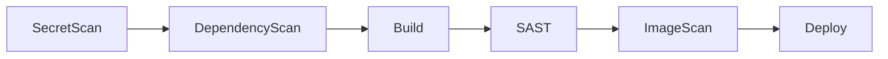

# CI/CD

애플리케이션 파이프라인을 만들고 돌리는 영역입니다. API 는 `/api/v1/cicd/**` 이고
**세 역할 모두** 호출할 수 있습니다.

[**CI/CD 템플릿**기본 템플릿을 골라 앱 배포 화면으로 들어간다.](templates.md)

[**골든패스**도구 조합이 정해진 추천 경로. 스택 설치로 이어진다.](golden-paths.md)

[**CI/CD 목록**파이프라인 상태·리소스·취약점·실행 이력을 본다.](list.md)

[**CI/CD 이력**배포 기록을 시간순으로 본다.](history.md)

[**앱 배포**developer 의 첫 화면. 앱 하나를 파이프라인으로 올린다.](app-deploy.md)

## 파이프라인이 실제로 돌리는 단계

Nullus 가 저장소에 써 주는 CI 정의는 아래 순서로 작업을 배치합니다. 조건이 맞지
않는 단계는 빠집니다.

| 단계 | 쓰는 도구 | 켜지는 조건 |
|------|----------|------------|
| `SecretScan` | gitleaks | **항상**. 실행 시 `NULLUS_SECRET_DETECTION=off` 로만 끕니다 |
| `DependencyScan` | Trivy (파일시스템) | 스택이 SCA 엔드포인트를 제공할 때 |
| `Build` | `docker build` / `docker push` | 항상 |
| `SAST` | sonar-scanner (`-Dsonar.qualitygate.wait=true`) | 스택이 SonarQube 를 제공할 때. 기본 브랜치에서만 |
| `ImageScan` | Trivy (이미지) | 스택이 Trivy 를 제공할 때 |
| `Deploy` | 매니페스트 태그를 바꿔 `[skip ci]` 로 커밋·푸시 | 항상 |

**앱 종류(web/backend/batch)로 갈리는 작업은 없습니다.** `web` 은 React 소스와
Dockerfile 이 더 들어가는 차이뿐입니다.

!!! note "실제 배포는 Argo CD 가 합니다"
    생성된 CI 안에 `argocd` CLI 나 sync 작업은 없습니다. `Deploy` 단계는 배포
    매니페스트의 이미지 태그를 바꿔 커밋하는 것까지이고, 그 커밋을 Argo CD 가
    따라가 반영합니다.

## 정의 파일은 CI 플랫폼이 결정합니다

소스 저장소가 아니라 **CI 플랫폼** 기준입니다.

| CI 플랫폼 | 써 주는 파일 |
|-----------|-------------|
| GitLab CI | `.gitlab-ci.yml` |
| GitHub Actions | `.github/workflows/nullus-ci.yml` |
| Jenkins | `Jenkinsfile` |

저장소 기본값은 GitLab → GitLab CI, GitHub → GitHub Actions, **Gitea → Jenkins**
입니다.

함께 커밋되는 파일: CI 정의, `Dockerfile`, `README.md`,
`deploy/deployment.yaml`, `deploy/service.yaml`, `.pre-commit-config.yaml`,
`.gitleaks.toml`. 게이트웨이 정보가 있으면 `deploy/httproute.yaml` 도 들어갑니다.

!!! warning "`deploy/ingress.yaml` 은 만들지 않습니다"
    [앱 배포](app-deploy.md) 화면의 "Deploy YAML 다시 읽기" 버튼이
    `deployment.yaml`·`service.yaml`·`ingress.yaml` 셋을 가져오려 하는데, 세 번째
    파일은 생성되지 않으므로 항상 404 가 납니다.

## 기본으로 들어 있는 템플릿 4개

`pipeline_templates` 테이블에 마이그레이션으로 들어갑니다.

| ID | 이름 | 앱 종류 | 기록된 stages |
|----|------|--------|--------------|
| `web-backend-v1` | User Custom Pipeline | backend | `Build`, `Deploy` |
| `batch-job-v1` | Batch Job Pipeline | batch | `Build`, `Deploy` |
| `nullus-sample-backend-v1` | Nullus Sample App — Backend | backend | `GitClone`, `DockerBuild`, `ImageLoad`, `Deploy` |
| `nullus-sample-frontend-v1` | Nullus Sample App — Frontend | web | 〃 |

!!! note "템플릿의 stages 는 실제 단계보다 적게 적혀 있습니다"
    시드가 만들어질 때 SecretScan 을 끈 상태로 계산돼서, 기록된 `stages` 가 실제로
    도는 단계보다 **최소 하나 적습니다.** 파이프라인별 실제 단계는 생성 시점에
    `pipelines.stages` 에 따로 기록됩니다.

    템플릿은 **도구를 묶지 않습니다** — 도구 선택은 스택에서 옵니다.
