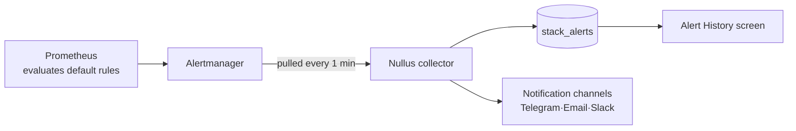

# Observability

This area shows the state of your installed stacks and the apps running on them. It has two screens.

[**Monitoring Dashboard**View pod, CPU, memory, and pipeline status, split into Cluster, Stack, and CI/CD tabs.](monitoring.md)

[**Alert History**View critical alerts raised by your stacks, in chronological order.](alert-history.md)

## Who evaluates alerts

**Nullus does not evaluate them itself.** The Prometheus in kube-prometheus-stack,
which is installed with each stack, evaluates the default rules. Nullus **pulls the
active alerts** from Alertmanager, records them, and sends them to your notification channels.

| Item | Value | Notes |
|------|-----|------|
| Collection interval | 1 minute | `NULLUS_STACK_ALERT_INTERVAL`; `off` or `0` turns it off; minimum 10 seconds |
| Collected from | Stacks that finished installing, have a namespace, and have monitoring collection turned on in stack settings | |
| Filter | `severity=critical` only | |
| Excluded alerts | `Watchdog`, `InfoInhibitor`, `KubeControllerManagerDown`, `KubeSchedulerDown`, `KubeProxyDown`, `etcd*` | |
| Re-notify interval | 4 hours | Notifies again while the alert keeps firing |
| Resolve grace period | 3 minutes | An alert absent for that long counts as resolved |

Silenced and inhibited alerts are still **pulled and recorded**. They just don't
send notifications.

!!! note "Resolved notifications only follow a firing notification"
    Nullus never sends a resolved notification for an alert it never announced as firing.
    If the Alertmanager query fails for a stack, Nullus skips that stack for the cycle and
    does not resolve its open alerts — so a lost connection is never misreported as
    "resolved".

## Custom alert rules do not exist yet

The screen for creating your own rules (`alert-rules-page.tsx`) and the backend CRUD
(`/api/v1/observability/alert-rules`) are in the repository, but **there is no loop
that evaluates the rules.** Rules are saved, and nothing happens.

So the screen was removed from both the sidebar and the routes, and
`web/src/app/routes.alert-rules.test.tsx` pins that decision in a test. Until a rule
editor exists, only **critical alerts from the stack's default rules** are delivered.
