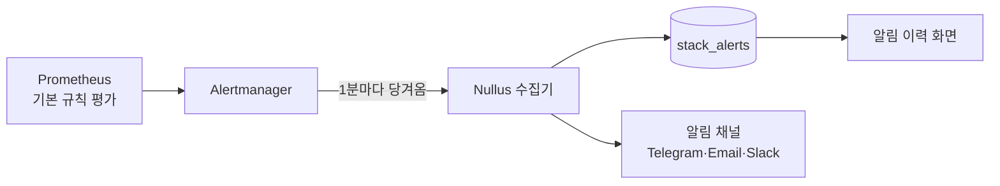

# 관측성

설치한 스택과 그 위에서 도는 앱의 상태를 보는 영역입니다. 화면은 셋입니다.

[**모니터링 대시보드**클러스터·스택·CI/CD 를 탭으로 나눠 파드·CPU·메모리·파이프라인 상태를 본다.](monitoring.md)

[**알림 이력**스택에서 발생한 심각 경보를 시간순으로 본다.](alert-history.md)

[**보안 대시보드**모든 스택 · 앱의 보안 게이트 결과와 설치 OSS 취약점을 한 화면에서 본다.](security-dashboard.md)

## 경보는 누가 평가하나

**Nullus 가 직접 평가하지 않습니다.** 스택에 함께 설치되는
kube-prometheus-stack 의 Prometheus 가 기본 규칙을 평가하고, Nullus 는
Alertmanager 에서 **활성 경보를 당겨와** 기록하고 알림 채널로 보냅니다.

| 항목 | 값 | 비고 |
|------|-----|------|
| 수집 주기 | 1분 | `NULLUS_STACK_ALERT_INTERVAL`, `off` 또는 `0` 이면 끔, 하한 10초 |
| 수집 대상 | 설치 완료 + 네임스페이스 있음 + 스택 설정에서 모니터링 수집을 켠 스택 | |
| 거르는 기준 | `severity=critical` 만 | |
| 제외 경보 | `Watchdog`, `InfoInhibitor`, `KubeControllerManagerDown`, `KubeSchedulerDown`, `KubeProxyDown`, `etcd*` | |
| 재알림 간격 | 4시간 | 계속 발생 중이면 다시 알린다 |
| 해제 유예 | 3분 | 그 시간 동안 안 보이면 해제로 본다 |

침묵(silence)·억제(inhibit) 된 경보도 **가져와서 기록**합니다. 다만 알림은
보내지 않습니다.

!!! note "해제 알림은 발생 알림이 있었을 때만 옵니다"
    발생을 알린 적 없는 경보는 해제도 알리지 않습니다. Alertmanager 조회가 실패한
    스택은 그 주기를 건너뛰고, 열린 경보를 해제하지 않습니다 — 연결이 끊긴 것을
    "해제됐다"로 잘못 보고하지 않기 위해서입니다.

## 사용자 정의 알림 규칙은 아직 없습니다

규칙을 직접 만드는 화면(`alert-rules-page.tsx`)과 백엔드 CRUD
(`/api/v1/observability/alert-rules`)는 저장소에 있지만, **규칙을 평가하는 루프가
없습니다.** 저장만 되고 아무 일도 일어나지 않습니다.

그래서 화면을 사이드바와 라우트 양쪽에서 내렸고, 그 결정을
`web/src/app/routes.alert-rules.test.tsx` 가 테스트로 고정하고 있습니다. 규칙
편집기가 생길 때까지는 **스택 기본 규칙의 심각 경보만** 전달됩니다.
