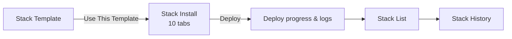

# DevSecOps Stack

This area installs validated OSS combinations on Kubernetes clusters and
manages them. Every API lives under `/api/v1/stacks/**`, and only
**admin and devops** can call them.

[**Stack Template**Pick a validated combination and go to install.](templates.md)

[**Stack Install**Fill in 10 tabs and deploy.](install.md)

[**Stack List**See installed stacks' status, workloads, config, and vulnerabilities.](list.md)

[**Stack History**Compare changes and roll them back.](history.md)

[**Stack Version**The tool-version compatibility matrix.](versions.md)

[**OSS Default Resource**Per-tool CPU and memory defaults.](oss-defaults.md)

[**Installed OSS CVE Response**How CVEs in installed OSS are reported and fixed, and by when.](cve-response.md)

## The path to an installed stack

1. On **Stack Template**, pick a combination and click `Use This Template`
2. You land on **Stack Install**; fill in the stack name, cluster, and namespace
3. Click `Deploy` to go to the **deploy progress screen** (`/stack/deploy/:id`) and watch the logs live
4. Manage the finished stack from **Stack List**

!!! note "Stack Install is not in the sidebar"
    It has no menu entry of its own; you reach it from a template. You can also
    open `/stack/install` directly by URL.

## Where devops gets stuck during install

!!! warning "The install wizard calls admin-only APIs"
    Both **admin and devops** can open `/stack/install`, but four pieces of
    data the screen needs come from **admin-only** paths.

    | What the wizard uses | API it calls | Role |
    |------------------|-----------|------|
    | Target cluster list | `GET /api/v1/admin/clusters` | admin |
    | Namespace list | `GET /api/v1/admin/clusters/{id}/namespaces` | admin |
    | StorageClass list | `GET /api/v1/admin/clusters/{id}/storage-classes` | admin |
    | Organization resource profiles | `GET /api/v1/admin/organization/resource-profiles` | admin |

    With authentication enabled, a devops user will most likely see these
    dropdowns empty because the calls return 403. We confirmed this by reading
    the code wiring; we have not reproduced it at runtime.
