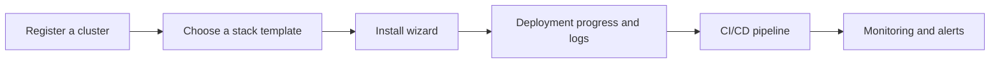

---
hide:
  - navigation
---

# Nullus Docs

An open-source platform that installs a verified DevSecOps stack **on Kubernetes without writing code**.
Pick a template, fill in the install wizard, and tools such as GitLab, Argo CD, Prometheus, and Grafana
come up in a single cluster, already integrated with each other.

[**Getting started**From prerequisites to running it locally. Start here if you are new.](getting-started/index.md)

[**Features at a glance**All 19 screens in one table: what each one does and who can use it.](features/index.md)

[**By role**What Admin, DevOps, and Developer each do.](roles/index.md)

[**End to end (E2E)**From an empty laptop through stack install, pipelines, backup, and restore in one pass.](getting-started/e2e.md)

## What it solves

When several projects run at the same time, you install pipelines on each project's Kubernetes
cluster over and over, and every team follows its own procedure, which makes standardization hard.
A combination such as GitLab, Argo CD, Prometheus, and Grafana means weighing version
compatibility and dependencies together, so deciding "which combination actually runs safely"
takes a lot of time.

Nullus packages those combinations in advance as **golden path templates**, unifies installation and
integration into **a single UI workflow**, and shows deployment progress and logs on **one screen**.

## Core flow

| Step | Screen | Docs |
|------|------|------|
| ① Register a cluster | `/admin/clusters` | [Cluster Management](features/admin/clusters.md) |
| ② Pick a template | `/stack/templates` | [Stack Template](features/stack/templates.md) |
| ③ Fill in the install wizard | `/stack/install` | [Stack Install](features/stack/install.md) |
| ④ Watch the deployment | `/stack/deploy/:id` | [Stack Install](features/stack/install.md) |
| ⑤ Create a pipeline | `/cicd/create` | [CI/CD List](features/cicd/list.md) |
| ⑥ Check the status | `/observability/monitoring` | [Monitoring Dashboard](features/observability/monitoring.md) |

## Sources

Screen routes, permissions, buttons, and APIs are taken from the code in the repository: the screen
list from `web/src/app/routes.tsx` and `web/src/components/layout/nav-model.tsx`, screen names from
`web/src/i18n/en.json`, and API paths from the Go router registrations. On any page, the pencil icon
at the top right opens the source of that page.

If you find a mistake, [let us know in an issue](https://github.com/cloud-nullus/nullus/issues).

## Implementation scope

There are 11 stack templates, covering three combinations: **GitLab** (All-in-One, Argo CD,
Harbor, Nexus, SonarQube, OTel), **GitHub + Argo CD** (repositories, Actions, and GHCR run as
external services, and only Argo CD and monitoring are installed in the cluster), and **Gitea + Jenkins +
Argo CD** (including Lite). GitLab is the most thoroughly verified path, and stabilization of the
CI/CD area is ongoing.

Features that do not work yet, or that are not exposed in the UI, are noted on each page.
