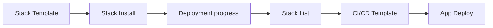

# DevOps

After login you land on the **Stack Template** (`/stack/templates`) screen. The sidebar
shows 11 items — only the Admin group and Stack Version Management are hidden.

## What you do

1. In **[Stack Template](../features/stack/templates.md)**, pick a combination and
   click `Use This Template`
2. In **[Stack Install](../features/stack/install.md)**, fill in the stack name,
   cluster, and namespace, then fine-tune the tabs. Run the 10 checks with
   **Dry Run**
3. `Deploy` → watch the logs on the deployment progress screen
4. In **[Stack List](../features/stack/list.md)**, check status, workloads, and
   vulnerabilities, and edit values on the **Config** tab if needed
5. Create a pipeline through **[CI/CD Template](../features/cicd/templates.md)** → **[App Deploy](../features/cicd/app-deploy.md)**
6. Keep an eye on things with **[Monitoring Dashboard](../features/observability/monitoring.md)** and
   **[Alert History](../features/observability/alert-history.md)**

## Menus you can see

| Group | Items |
|------|------|
| DevSecOps Stack | Stack Template · Stack List · Stack History · Stack Version · OSS Default Resource (5) |
| CI/CD | CI/CD Template · Golden Paths · CI/CD List · CI/CD History (4) |
| Observability | Monitoring Dashboard · Alert History (2) |

The **Create Template, Edit, and Delete** buttons on Stack Template are visible only to admin.
The **Stack Version Management** screen, where you edit the compatibility matrix, is also admin-only.

## Where you get stuck

!!! warning "The install wizard's dropdowns may be empty"
    `/stack/install` is open to devops, but four things the screen needs to fill in
    come from **admin-only APIs** — target cluster, namespace,
    StorageClass, and organization resource profile.

    With authentication enabled, these selections will likely show up empty because
    of 403s. In that case, ask an admin to register the cluster and save the
    resource profile.

!!! warning "What does not work today"
    | Feature | Status | Alternative |
    |------|------|------|
    | **Rollback** in Stack History | Request format mismatch, returns 400 | Edit values directly on the Config tab in [Stack List](../features/stack/list.md) |
    | **Validate Current Stack** in Stack Version | Missing server wiring, returns 400 | Dry Run in the install wizard |
    | **Status filter** in CI/CD List | Values do not match, so the table empties | Use the search box |
    | Build and deploy settings in the Execute dialog | Not sent | — |
    | Server-side Pre-Deploy Gate | Disabled | Client-side checks and Dry Run |
